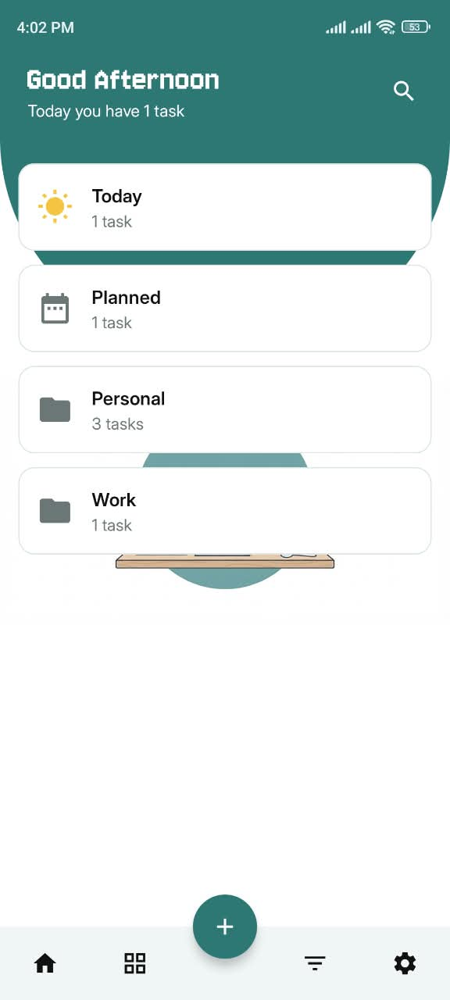
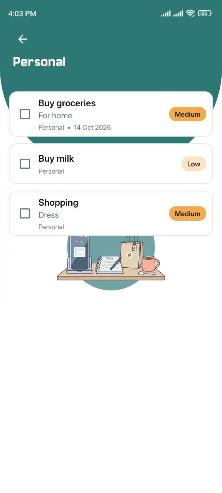
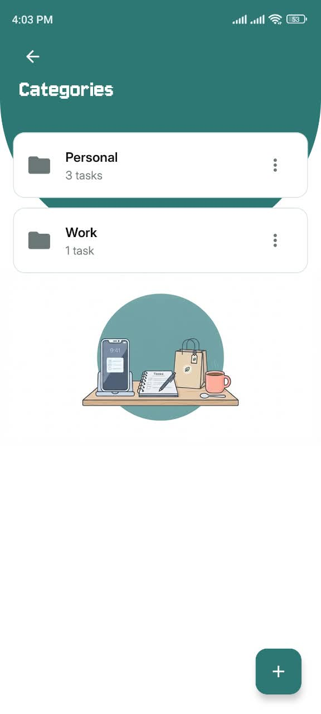
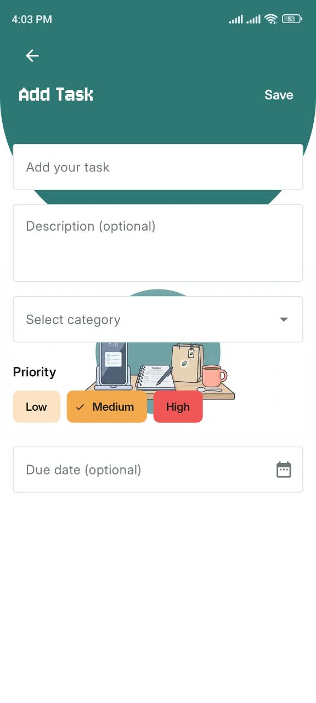
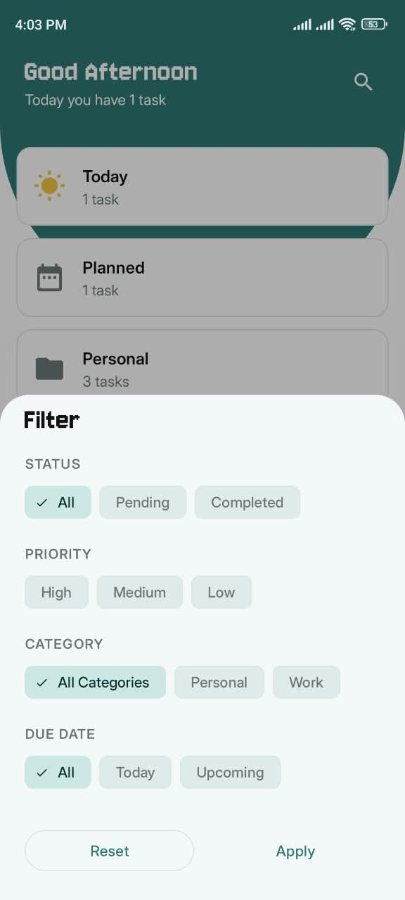
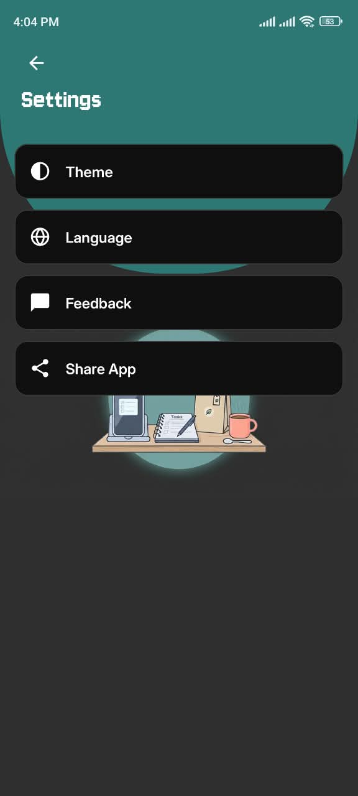

# TaskFlow

A clean, offline-first to-do app for Android. Organize tasks into your own categories, set priorities and optional due dates, and find anything quickly with search and filters.

> "Organize your day, one task at a time."
> ## Live Demo

Try TaskFlow instantly in your browser — no install needed:

🔗 **[Launch Live Demo on Appetize.io](https://appetize.io/app/b_qtbikiw3ebcnp6g4zecimhtutu)**


<!-- Screenshots: add your files to docs/screenshots/ and update the names below -->
| Home | Task list | Categories |
|:---:|:---:|:---:|
|  |  |  |

| Add task | Filter | Dark mode |
|:---:|:---:|:---:|
|  |  |  |

## Features

- **Home dashboard** with a time-based greeting, the number of tasks due today, and live counts for Today, Planned and every category
- **Tasks**: add, edit, delete, and mark complete or incomplete; swipe to delete with **Undo**
- **Optional due dates**: a task can have no date at all. Today means due today, Planned means due in the future
- **Priorities**: Low, Medium, High with colour coding
- **User-managed categories**: add, rename and delete. Deleting a category keeps its tasks (they become uncategorized)
- **Search** across task titles and descriptions
- **Filter** by status, priority, category and due date from a bottom sheet, with an active-filter indicator
- **Light, Dark and System Default** themes, remembered between launches
- **Settings**: theme, language, feedback (opens your email app) and share app
- **Empty states**, exit confirmation and edge-to-edge UI
- Fully **offline**: all data stays on the device

## Tech stack

| Area | Choice |
|---|---|
| Language | Kotlin |
| UI | XML layouts, ViewBinding, Material 3 |
| Navigation | Navigation Component (single Activity, Fragments) |
| Architecture | MVVM + Repository pattern |
| Local storage | Room (with KSP) |
| Async / reactive | Kotlin Coroutines, Flow and StateFlow |
| Lists | RecyclerView, ListAdapter + DiffUtil, ItemTouchHelper |
| Splash | AndroidX SplashScreen API |
| Min / target SDK | 24 / 36 |

No login, no networking, no cloud sync, and no dependency-injection framework: the app wires its few dependencies by hand in the `Application` class to keep the code easy to follow.

## Architecture

```
UI (Fragments)  ->  ViewModel  ->  Repository  ->  DAO  ->  Room database
```

- **Fragments** only draw state and forward user actions
- **ViewModels** expose `StateFlow`s and hold form and filter logic
- **Repositories** are the only layer that talks to the DAOs
- **DAOs** hold the SQL; queries return `Flow`, so the UI updates itself when data changes

One reusable **Task List** screen serves Today, Planned, every category, Search and Filter results. Only its data source changes.

### Project structure

```
com.taskflow.app
├── data
│   ├── local
│   │   ├── dao          TaskDao, CategoryDao
│   │   ├── entity       Task, Category, Priority
│   │   └── model        TaskWithCategory, CategoryWithCount, TaskFilter
│   ├── repository       TaskRepository, CategoryRepository
│   └── FilterStore.kt   shared filter state
├── ui
│   ├── splash  home  tasklist  categories  addtask  filter  settings
├── viewmodel            Home, TaskList, Categories, AddTask
└── util                 dates, insets, theme, swipe-to-delete helpers
```

### Database

| `categories` | `tasks` |
|---|---|
| `id` (PK) | `id` (PK) |
| `name` | `title`, `description?` |
| | `categoryId?` -> `categories.id` (`SET_NULL` on delete) |
| | `priority` (LOW / MEDIUM / HIGH) |
| | `dueDate?` (start of day, millis) |
| | `isCompleted` |

## Design decisions

- **Due date is nullable.** A task without a date appears in neither Today nor Planned, but is found by search, category and filter views.
- **Dates are stored as local start-of-day** timestamps, which keeps the Today and Planned queries simple and correct. The Material date picker works in UTC, so values are converted both ways (and unit tested).
- **Counts show pending tasks only**, so completing a task lowers the numbers immediately.
- **Deleting a category never deletes tasks.** A foreign key with `SET_NULL` handles this in the database, so no code can forget to do it.
- **Undo restores the same task** (same id), so it behaves exactly like it was never deleted.
- **Category creation lives only on the Categories screen.** The task form can only pick from existing categories, and guides the user to create one first.

## Getting started

1. Clone the repository
```
   git clone https://github.com/DevWithMaryam/TaskFlow.git
```
2. Open it in a recent Android Studio (one that supports Android Gradle Plugin 8.11) and let Gradle sync
3. Run the `app` configuration on an emulator or a device (Android 7.0+)

Run the unit tests with **right-click `app/src/test` -> Run Tests**, or `./gradlew test`.

## Possible next steps

- Add more languages (the settings screen and `locales_config.xml` are already set up for it)
- Instrumented UI tests for the main flows
- Task reminders (intentionally left out of version 1)

## Author

Built by **DevWithMaryam**.

- GitHub: [DevWithMaryam](https://github.com/DevWithMaryam)
- LinkedIn: [linkedin.com/in/maryam-akram-2b183b338](https://www.linkedin.com/in/maryam-akram-2b183b338)